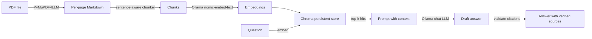

# Chat with your PDFs 📄

Ask questions over any PDF and get **grounded answers with page citations** — 100% locally.
No API keys, no cloud LLM calls, your documents never leave your machine.

Project #1 in my RAG portfolio series (20 projects, one repo each, shipped daily).

## Why this exists

Most RAG demos paste a PDF into a vector store and pray. This one does the boring
production things properly:

- **Table-safe, sentence-aware chunking** — fixed-token splitters cut tables mid-row and
  answers mid-sentence. My chunker treats Markdown tables as atomic units and splits prose
  only on sentence boundaries, with configurable overlap.
- **Validated citations** — naive LLMs invent `[p. 42]` tokens. Every citation in the answer
  is checked against the pages actually retrieved; hallucinated ones are stripped and reported.
- **Refusal guardrail** — if the answer isn't in your documents, it says so instead of making
  one up.

## Architecture



Stack: Python 3.12+, PyMuPDF4LLM (Markdown parsing), Chroma (embedded vector store),
Ollama (local embeddings + chat), Streamlit (UI), pytest (tests).

## Quickstart

```bash
# 1. Prereq: Ollama running locally with the models pulled
ollama pull nomic-embed-text      # embeddings (~274 MB)
ollama pull bonsai-2:4b           # chat LLM (~1.6 GB, swap in any model via PDFCHAT_CHAT_MODEL)

# 2. Install
python -m venv .venv && source .venv/bin/activate
pip install -r requirements.txt

# 3. Ingest a PDF
PYTHONPATH=src python -m pdfchat.ingest sample_data/attention.pdf --fresh

# 4. Ask
PYTHONPATH=src python -m pdfchat.cli "How does multi-head attention work?"

# 5. Or use the chat UI
PYTHONPATH=src streamlit run app.py
```

> `PYTHONPATH=src` is needed because the package lives in `src/` (or `pip install -e .`).

## Demo (real output, 2026-10-27, all-local models)

```
$ python -m pdfchat.cli "How does multi-head attention work and why is it better than single-head?"

Multi-head attention works by linearly projecting the queries, keys, and values $h$ times
with different, learned linear projections to specific dimensions, and then performing the
attention function in parallel on each projected version [p. 4]. It is better than
single-head because multi-head attention allows the model to jointly attend to information
from different representation subspaces at different positions, whereas with a single
attention head, averaging inhibits this capability [p. 5].

--- sources ---
p.2  attention.pdf  score=0.715
p.4  attention.pdf  score=0.738
p.5  attention.pdf  score=0.764
...
```

```
$ python -m pdfchat.cli "What are the BLEU scores reported for the big transformer on WMT 2014 English-to-German?"

The BLEU score reported for the big transformer on WMT 2014 English-to-German is 28.4 [p. 8].
```

```
$ python -m pdfchat.cli "What year did the Roman empire fall?"

I could not find that in the documents.
```

## Tests

11 pytest cases covering the two pieces that actually break in RAG systems —
the chunker (table atomicity, sentence boundaries, no lost text, overlap) and the
citation validator (hallucinated pages stripped):

```
$ pytest tests/ -q
11 passed
```

## Design decisions

| Decision | Why |
|---|---|
| Page-level Markdown from PyMuPDF4LLM | keeps page numbers as first-class metadata for citations |
| Tables atomic in chunker | a chunked table = garbage retrieval + broken answers (the #1 chunking failure mode) |
| Citation post-validation | prompt-only citation rules are not trustworthy; strip what wasn't retrieved |
| Local Ollama for embed+LLM | zero cost, offline, private; models swappable via env vars |
| Chroma embedded | one less docker-compose service; swap for Qdrant when filtering matters |

## Roadmap

- [ ] Cross-encoder reranker + Ragas faithfulness/precision eval table (before/after)
- [ ] Docling fallback for scanned/multi-column PDFs (no clean text layer)
- [ ] Parent-document retrieval (retrieve small, feed the LLM the big block)
- [ ] Deploy to Streamlit Community Cloud

## License

MIT (this code). Note: the `pymupdf4llm` parsing dependency is AGPL-3.0 — for a commercial
product you'd swap in Docling or an alternative parser; the interface in `parse.py` isolates it.
